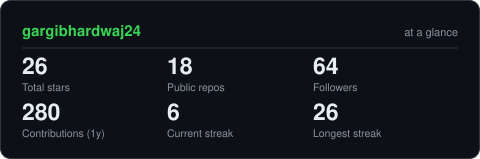

<div align="center">

<!-- PORTRAIT - generated by scripts/dotify.py from assets/jacket.png.
     Colour mode, so one file serves both GitHub themes. Regenerate with:
       python scripts/dotify.py assets/jacket.png -o assets/portrait \
         --square --focus 0.5,0.38 --cols 100 --equalize --detail 0.5 --color --reveal -->


<br>

<!-- NAME / TAGLINE - animated typing -->
<a href="https://github.com/Asad2512-dev">
  
</a>

<br>

<!-- SOCIALS -->
<a href="https://www.linkedin.com/in/asadullah2512/"></a>
<a href="mailto:masadullah1206@gmail.com"></a>
<a href="https://codebyasad.com"></a>


</div>

---

## `~/` whoami

```console
$ cat about.txt
```

Hi, I'm **Muhammad Asad Ullah** — a Software Engineer with **3+ years of professional
experience** across Flutter/mobile development, full-stack web development, backend
engineering, APIs, and AI integration. I build production-ready applications with a
focus on clean architecture, performance, scalability, security, and good UX.

- Strongest area: **Flutter & mobile development** — shipped apps live on the App Store and Google Play
- Full-stack: **React / Next.js** on the frontend, **Laravel / Node.js / Firebase** on the backend
- Currently expanding into: **AI Engineering, Cloud Engineering, DevOps & Cybersecurity**
- Portfolio: **[codebyasad.com](https://codebyasad.com)**
- Philosophy: **"Don't just make it work. Build it so it can grow."**

<br>

<div align="center">

## `~/` toolbox


</div>

---

<div align="center">

## `~/` skill radar

<table>
<tr>
<td width="50%" align="center" valign="middle">

<!-- Self-rated radar - edit assets/skills.json, the workflow redraws it -->
<picture>
  <source media="(prefers-color-scheme: dark)"  srcset="assets/radar-dark.svg">
  <source media="(prefers-color-scheme: light)" srcset="assets/radar-light.svg">
  
</picture>

</td>
<td width="50%" align="center" valign="middle">

<!-- Live radar built from real language byte counts across your repos -->
<picture>
  <source media="(prefers-color-scheme: dark)"  srcset="assets/radar-langs-dark.svg">
  <source media="(prefers-color-scheme: light)" srcset="assets/radar-langs-light.svg">
  
</picture>

</td>
</tr>
</table>

</div>

---

<div align="center">

## `~/` contribution calendar

<!-- 3D isometric calendar, regenerated every 6h by .github/workflows/metrics.yml -->


<br><br>

<!-- Snake eats the contribution graph - .github/workflows/snake.yml -->
<picture>
  <source media="(prefers-color-scheme: dark)"  srcset="https://raw.githubusercontent.com/Asad2512-dev/Asad2512-dev/output/snake-dark.svg">
  <source media="(prefers-color-scheme: light)" srcset="https://raw.githubusercontent.com/Asad2512-dev/Asad2512-dev/output/snake.svg">
  
</picture>

</div>

---

<div align="center">

## `~/` the numbers

<!-- Generated by scripts/cards.py into this repo. Deliberately NOT
     github-readme-stats / streak-stats / github-profile-trophy: those are
     shared public instances that go down and take the whole section with them. -->
<picture>
  <source media="(prefers-color-scheme: dark)"  srcset="assets/card-stats-dark.svg">
  <source media="(prefers-color-scheme: light)" srcset="assets/card-stats-light.svg">
  
</picture>

<br>


<br><br>


</div>

---

<div align="center">

## `~/` selected work

</div>

**📱 Live mobile apps**

| app | platform | link |
|---|---|---|
| **Lite Nurse Clinic** | iOS | [App Store](https://apps.apple.com/pk/app/lite-nurse-clinic/id6753748640) |
| **Smart Prepx** | Android | [Google Play](https://play.google.com/store/apps/details?id=com.smartprepx.app&hl=en) |
| **SmartCubz Connect** | Android | [Google Play](https://play.google.com/store/apps/details?id=com.smartcubz.connect) |
| **Beyond Today** | iOS | App Store |
| **GoBirr** | iOS | App Store |
| **GoBirr Provider** | iOS | App Store |

**🌐 Live web projects**

| project | type | link |
|---|---|---|
| **CodeByAsad** | Personal portfolio | [codebyasad.com](https://codebyasad.com) |
| **Rayvon Scents** | E-commerce | [rayvonscents.com](https://rayvonscents.com) |
| **Flames & Shakes** | Business site | [flamesandshakes.com](https://flamesandshakes.com) |
| **Pak Enterprises Tiles** | Business site | [pakenterprisestiles.com](https://pakenterprisestiles.com) |
| **Read Holy Quran** | Web platform | [readholyquran.online](https://readholyquran.online) |
| **Zawaaral** | Web project | [zawaaral.com](https://zawaaral.com/) |
| **Dr. Farhan Siddique** | Professional site | [drfarhansiddique.com](https://drfarhansiddique.com/) |
| **Total Cash Pro** | Web platform | [totalcashpro.com](https://totalcashpro.com/) |
| **Tangled Synapses** | Digital platform | [tangledsynapses.com](https://tangledsynapses.com/) |
| **Tangled Synapses Aviation** | Aviation platform | [tangledsynapsesaviation.com](https://tangledsynapsesaviation.com/) |

---

<div align="center">

<sub>`01110100 01101000 01100001 01101110 01101011 01110011 00100000 01100110 01101111 01110010 00100000 01110011 01100011 01110010 01101111 01101100 01101100 01101001 01101110 01100111`</sub>

</div>
