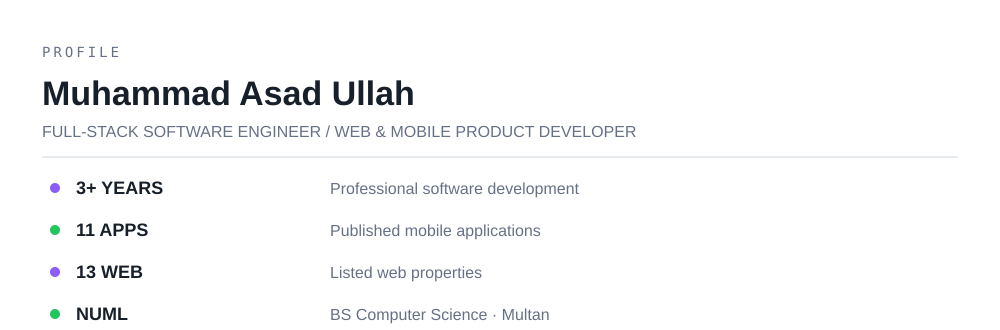
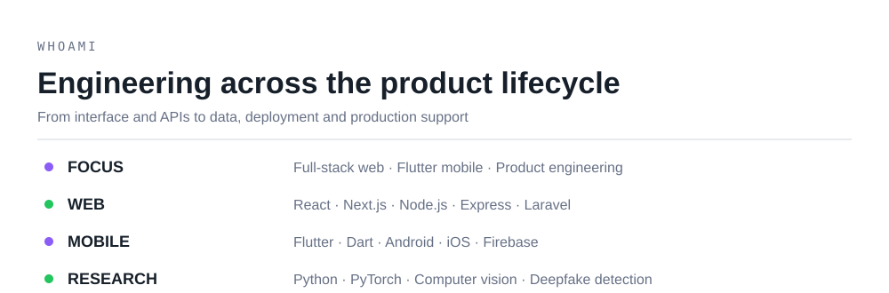
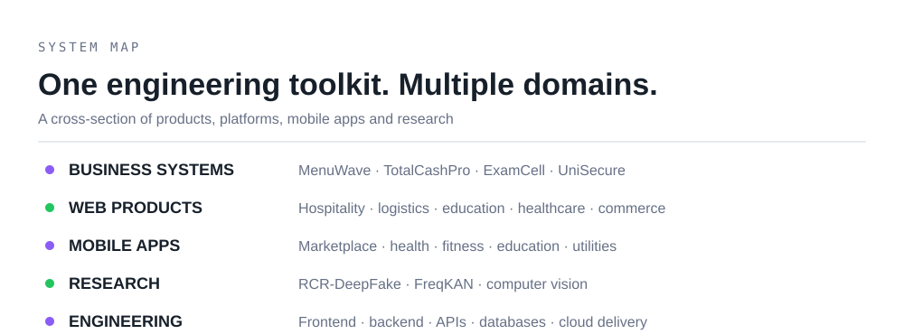
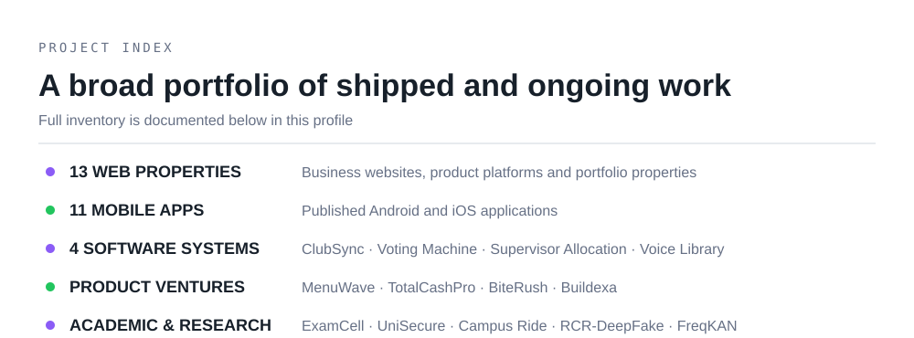
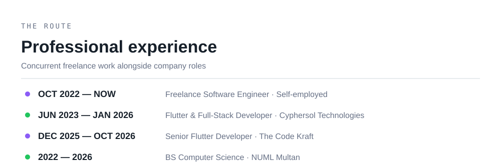
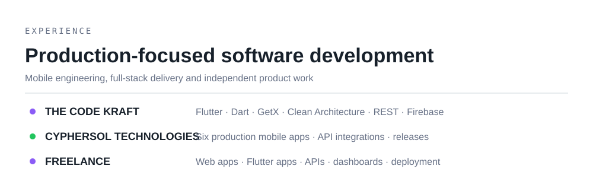
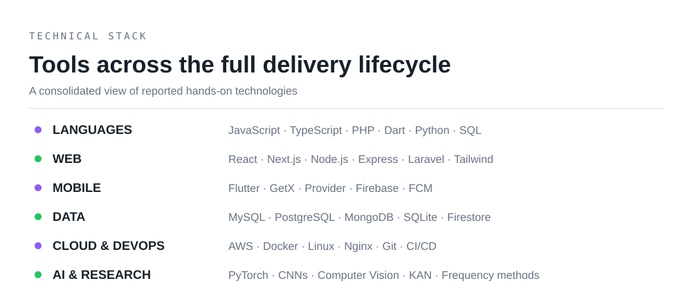
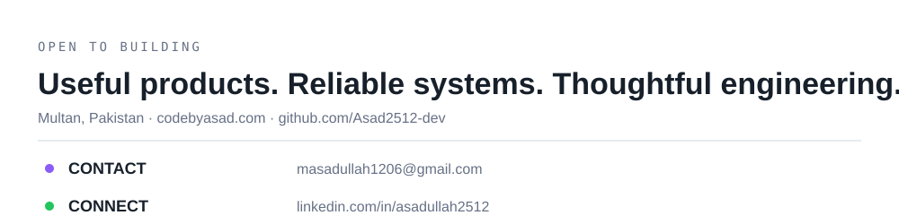

<picture>
  <source media="(prefers-color-scheme: dark)" srcset="assets/dark/header-v1.svg">
  
</picture>

**Multan, Pakistan · 3+ years of software development experience**

<picture><source media="(prefers-color-scheme: dark)" srcset="assets/dark/whoami.svg"></picture>

## About me

I'm **Muhammad Asad Ullah**, a Full-Stack Software Engineer focused on building complete web and cross-platform mobile products. My work spans frontend interfaces, backend services, REST APIs, databases, authentication, deployment and ongoing production maintenance.

I enjoy turning practical requirements into maintainable software — from responsive web platforms and Flutter applications to multi-role business systems and research implementations. I also explore computer vision and deep learning, particularly frequency-domain methods and deepfake detection.

- **Current professional identity:** Full-Stack Software Engineer · Web & Mobile Application Developer
- **Core strengths:** Flutter, React/Next.js, Node.js/Express, Laravel/PHP, REST APIs and database-driven systems
- **Reported portfolio:** 11 published mobile applications and 13 listed web properties
- **Education:** BS Computer Science, National University of Modern Languages (NUML), Multan
- **Achievement:** First Place — MNS University Library App Development Competition, 2025
- **Portfolio:** [codebyasad.com](https://codebyasad.com)

<picture><source media="(prefers-color-scheme: dark)" srcset="assets/dark/ecosystem.svg"></picture>

## Project portfolio

The inventory below includes the web properties, mobile applications, standalone software systems, product ventures and research projects documented in my professional profile. Some are client or business properties, some are academic projects, and some are products or research initiatives; they should not be interpreted as 28 independent commercial engagements.

### Web properties — 13 listed

| # | Project | Focus | Link |
|---:|---|---|---|
| 1 | **Total Cash Pro** | Hospitality back-office and financial operations | [totalcashpro.com](https://totalcashpro.com) |
| 2 | **LabelBuddy** | Shopify / EU energy-label web project | [labelbuddy.co.uk](https://labelbuddy.co.uk) |
| 3 | **MenuWave** | Restaurant operations and digital ordering platform | [menuwave.com](https://menuwave.com) |
| 4 | **Zawaaral 3PL** | Logistics, warehousing, freight and fulfillment | [zawaaral.com](https://zawaaral.com) |
| 5 | **Pak Enterprises Tiles** | Product catalog, tile calculator and WhatsApp inquiries | [pakenterprisestiles.com](https://pakenterprisestiles.com) |
| 6 | **Dr. Farhan Siddique** | Academic profile, research and publications | [drfarhansiddique.com](https://drfarhansiddique.com) |
| 7 | **Read Holy Quran** | Quran reading website | [readholyquran.online](https://readholyquran.online) |
| 8 | **Tangled Synapses** | Main brand website | [tangledsynapses.com](https://tangledsynapses.com) |
| 9 | **Tangled Synapses Aviation** | Aviation vertical website | [tangledsynapsesaviation.com](https://tangledsynapsesaviation.com) |
| 10 | **Tangled Synapses Marine** | Marine vertical website | [tangledsynapsesmarine.com](https://tangledsynapsesmarine.com) |
| 11 | **Tangled Synapses Energy** | Energy vertical website | [tangledsynapsesenergy.com](https://tangledsynapsesenergy.com) |
| 12 | **CodeByAsad** | Personal software engineering portfolio | [codebyasad.com](https://codebyasad.com) |
| 13 | **Flames & Shakes** | Food-service / restaurant web project | Link not listed in profile |

### Published mobile applications — 11 reported

| # | Application | Known focus |
|---:|---|---|
| 1 | **GoBirr** | Location-based services marketplace |
| 2 | **GoBirr Provider** | Provider-side marketplace and service management |
| 3 | **Beyond Today** | Digital legacy application |
| 4 | **Lite Nurse Clinic** | Healthcare consultation and appointments |
| 5 | **Blueprint Health & Fitness** | Workout programs and progress tracking |
| 6 | **SmartPrepX** | MCQs, past papers and practice assessments |
| 7 | **Online Barber** | Barber / salon booking |
| 8 | **Smart Cubz** | Published mobile application |
| 9 | **Urdu Poetry** | Poetry and content application |
| 10 | **Top Coaches** | Published mobile application |
| 11 | **QuickSaver** | Utility application |

*Store URLs and detailed feature descriptions for some apps were not included in the source profile.*

### Other software systems

| Project | Technology | What it does |
|---|---|---|
| **ClubSync** | React, Node.js, Express, MySQL, Sequelize, Tailwind | Sports club management: players, ground booking, events, notifications and analytics |
| **Electronic Voting Machine** | React, Node.js, Express, MongoDB, JWT | Voter authentication, candidate management, duplicate-vote protection, audit trails and results |
| **Academic Supervisor Allocation System** | Laravel, Blade, Tailwind, Alpine.js, MySQL | Supervisor capacity, proposals, expertise-based matching and allocation workflows |
| **Voice Library** | React, TypeScript, Vite, Web Speech API | Voice navigation, speech-controlled reading and accessible digital-library features |

### Product ventures and larger platforms

- **Buildexa Technologies** — software-company brand and product ecosystem.
- **MenuWave** — multi-tenant restaurant operating system spanning administration, operations, POS, kitchen workflows, customer ordering and digital signage.
- **TotalCashPro** — hospitality back-office concept for centralized operations across multiple restaurants.
- **BiteRush** — food-service product venture with admin-managed landing-page content and promotional sections.
- **ExamCell** — AI-assisted examination management system with admin, teacher and student portals; academic setup, exam planning, seating, invigilation, marks, results and analytics.
- **UniSecure** — campus attendance and gate-security system with role-based workflows, attendance, face verification and optional NFC.
- **Campus Ride** — Flutter/Firebase campus-ride application concept.

### Research and machine learning

- **RCR-DeepFake** — research into cross-generator deepfake video detection using spatial-frequency-temporal camera-residual consistency.
- **FreqKAN / FreqKANPP** — frequency-domain feature processing, KAN / ConvKAN architectures and image-classification research.

<picture><source media="(prefers-color-scheme: dark)" srcset="assets/dark/projects.svg"></picture>

## Professional experience

<picture><source media="(prefers-color-scheme: dark)" srcset="assets/dark/timeline.svg"></picture>

### Senior Flutter Developer — The Code Kraft
**December 2025 – October 2026 · Remote**

- Developed and maintained Flutter web and mobile experiences.
- Worked with Dart, GetX and Clean Architecture principles.
- Built reusable UI components and integrated REST APIs and Firebase-backed services.
- Contributed to authentication, content delivery, notifications, debugging and production maintenance.

### Flutter & Full-Stack Developer — Cyphersol Technologies
**June 2023 – January 2026 · Multan, Pakistan**

- Worked across six production mobile applications for Android and iOS.
- Integrated REST APIs, Firebase, authentication and push notifications.
- Contributed to real-time workflows, stability improvements, architecture refactoring and release processes.
- Previously reported outcomes include a 25% improvement in application stability and a 30% reduction in feature development time; these are retained as reported figures.

### Freelance Software Engineer — Self-employed
**October 2022 – Present**

- Delivered web and mobile projects using React, Next.js, Laravel, Node.js, PHP and Flutter.
- Built APIs, database integrations, authentication, dashboards and third-party integrations.
- Supported deployment, server configuration, bug fixing and ongoing maintenance.

<picture><source media="(prefers-color-scheme: dark)" srcset="assets/dark/experience.svg"></picture>

## Technical skills

<picture><source media="(prefers-color-scheme: dark)" srcset="assets/dark/stack.svg"></picture>

| Area | Technologies |
|---|---|
| **Languages** | JavaScript, TypeScript, PHP, Dart, Python, SQL, HTML5, CSS3 |
| **Frontend** | React.js, Next.js, Tailwind CSS, Laravel Blade, Alpine.js, Vite |
| **Backend** | Node.js, Express.js, Laravel, REST APIs, MVC, authentication, RBAC |
| **Mobile** | Flutter, Dart, GetX, Provider, Android, iOS, Flutter Web |
| **Databases** | MySQL, PostgreSQL, MongoDB, SQLite, Firestore, Firebase Realtime Database |
| **ORM** | Sequelize, Laravel Eloquent |
| **Cloud & DevOps** | AWS EC2, AWS S3, Docker, Linux, Nginx, Git, GitHub, CI/CD |
| **Security** | JWT, OAuth2, RBAC, AES, bcrypt |
| **AI / Research** | Python, PyTorch, CNNs, computer vision, frequency-domain analysis, KAN / ConvKAN |

*BLoC, Riverpod and some architecture patterns have appeared in earlier profile material; proficiency levels should be confirmed before describing them as advanced skills.*

## Education & achievement

**BS Computer Science** — National University of Modern Languages (NUML), Multan · 2022–2026

**First Place** — MNS University Library App Development Competition, 2025

## GitHub overview

[View my GitHub profile](https://github.com/Asad2512-dev) · [Explore repositories](https://github.com/Asad2512-dev?tab=repositories) · [View contribution history](https://github.com/Asad2512-dev?tab=overview)

## Let's connect

I'm interested in building useful products, solving practical engineering problems, collaborating with strong teams and exploring thoughtful applications of AI and software engineering.

- **Portfolio:** [codebyasad.com](https://codebyasad.com)
- **GitHub:** [@Asad2512-dev](https://github.com/Asad2512-dev)
- **LinkedIn:** [asadullah2512](https://linkedin.com/in/asadullah2512)
- **Email:** [masadullah1206@gmail.com](mailto:masadullah1206@gmail.com)

<picture><source media="(prefers-color-scheme: dark)" srcset="assets/dark/footer.svg"></picture>

*Build thoughtfully. Ship reliably. Keep learning.*

